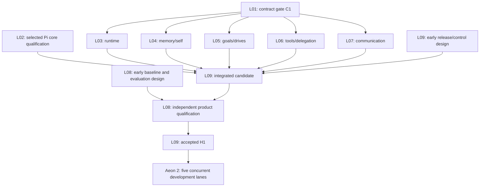

# Aeon implementation and self-improvement plan

**2026-10-12 scoped deployment:** the [first live Slack pilot](docs/rewrite/slack-pilot.md) runs as `aeon-pilot.service`, with actual model/tool/direct-conversation completion and a user-confirmed live Slack reply. Only observed launch/conversation blockers were repaired; the user's subsequent ingestion-indicator request is separately scoped in the pilot record. The broader backlog remains hibernated; the previous repair-first restart order does not govern this pilot. Agents use Sol only.

Planning baseline: **2026-10-11**. Full rewrite; **no legacy support**. The old systemd installation is [decommissioned](docs/rewrite/decommission.md). Aeon 1 implementation is authorized but **hibernated at the user’s request on 2026-10-12**. Read the [restart guide](docs/rewrite/RESUME.md) before resuming; it records exact checkpoints, unresolved findings and the next parallel tasks. All prior ownership claims are inactive until explicitly reclaimed. The [execution record](docs/rewrite/execution.md) preserves integration and evidence. Planning specifications alone do not establish implemented or deployed capabilities.

The three dimensions are **Aeon → Lane → Task**: who carries the responsibility, which independent session owns an outcome, and what concrete work its subagents can complete. Maintaining this structure is itself [requirement RW19](REQUIREMENTS.md) and is enforced by [AGENTS.md](AGENTS.md) and the [planning workflow](docs/rewrite/workflow.md).

## Read before claiming work

1. [Requirements](REQUIREMENTS.md) and [diagnosis](docs/rewrite/findings.md): intended outcomes, observed limitations and relation to the old P01–P18 plan.
2. [Architecture](docs/rewrite/architecture.md), [agent-shell comparison and decision procedure](docs/rewrite/agent-shell-decision.md), and [ADR 0031](docs/adr/0031-aeon-rewrite-and-prompt-sovereignty.md): proposed design, owned prompts and reuse/fork/build choice.
3. [Acceptance](docs/acceptance.md), [open decisions](docs/open-decisions.md), and [reuse ledger](docs/rewrite/reuse-ledger.md): evidence gates and unresolved choices with owners.
4. Your lane and its dependencies. Copy the lane's `/goal` into a fresh session, claim ownership, and delegate its concrete tasks using the listed model/effort guidance. This plan does not automatically launch those sessions.

Primary model selected by the user on2026-10-12: **Mistral Large4 with high reasoning**, `mistral-large-4-0`. [ADR0034](docs/adr/0034-select-mistral-large-4-reasoning.md) and the [selection record](docs/rewrite/model-selection.json) supersede the earlier Medium3.5 proposal. Exact runtime profile, account/context/tokenizer and competence qualification remain open; Pi remains the shell.

The user's2026-10-12 requirement makes **all environmental access injectable for mocking**, including evaluation and deployment. The adopted [DI workstream](docs/rewrite/evidence/A1-L09/environment-di-plan.md) adds29 finite, independently ownable tasks to the baseline lanes; [DI01](docs/rewrite/evidence/A1-L01/environment-di-01.md) freezes local port and trusted-composition semantics. Execution claims remain mandatory. The final DI closure review is an Aeon1 engineering gate; the initial clock/worker slice does not complete it.

## Aeon 1 — Codex bootstraps the evolving mind-self

The [technical overview](docs/rewrite/aeon-1.md) defines contract gate C1, parallel waves W0–W3 and capability handoff H1. Nine independently ownable lanes contain **48 delegable tasks**.

| Lane | Session outcome | Start condition |
|---|---|---|
| [A1-L01 — Contracts](docs/rewrite/lanes/A1-L01-contracts.md) | Executable boundaries, state/evidence contracts and justified design decisions | Ready for specification |
| [A1-L02 — Agent shell](docs/rewrite/lanes/A1-L02-agent-shell.md) | Selected Pi core, prompt/transport qualification, editable dependencies and replaceable adapter | Choice recorded in ADR 0032; extraction/qualification can start, integrated bridge uses C1 |
| [A1-L03 — Durable runtime](docs/rewrite/lanes/A1-L03-durable-runtime.md) | Resumable action/observation work, resource accounting and effect reconciliation | Boundary proposals now; implementation against C1 |
| [A1-L04 — Memory and self](docs/rewrite/lanes/A1-L04-developmental-memory.md) | Developmental retrieval, consolidation, provenance and revisable self | Boundary proposals now; C1 and fake event stream |
| [A1-L05 — Goals and drives](docs/rewrite/lanes/A1-L05-goals-and-drives.md) | Persistent goals, self-directed initiative, scheduling and obligations | Boundary proposals now; C1 and fake executor/clock |
| [A1-L06 — Tools and delegation](docs/rewrite/lanes/A1-L06-tools-and-delegation.md) | Real research/coding tools, inspect/edit/test/repair and integrated subagent work | Boundary proposals now; C1 and fake effect receiver |
| [A1-L07 — Communication](docs/rewrite/lanes/A1-L07-communications.md) | Responsive Slack/direct interaction, recovery and honest follow-through | Coverage design now; C1 and fake runtime |
| [A1-L08 — Evaluation](docs/rewrite/lanes/A1-L08-evaluation.md) | Independent competence, development and Codex/Claude comparisons | Workload and baseline design can start now |
| [A1-L09 — Integration and evolution](docs/rewrite/lanes/A1-L09-integration-and-handoff.md) | Recoverable fresh installation, whole-system self-release and H1 | Control/release design now; final acceptance after L01–L08 |

Run L01 contract design, L02 selected-core qualification, L08 baseline design and L09 control-boundary design in parallel first. Then build L03–L07 independently against agreed fixtures while selected-core qualification proceeds. Integrate progressively; [ADR 0032](docs/adr/0032-select-pi-core-and-source-owned-dependencies.md) selects Pi; its qualification does not wait for the final product benchmark. L08's full comparisons and L09's end-to-end recovery/evolution demonstrations determine H1. Root configuration and lockfile changes are serialized by L09, while other code has disjoint ownership.

This diagram shows integration dependencies; lane task tables contain the finer specification and fixture dependencies. Review and evidence work can proceed in parallel with authoring; effectful releases and shared-contract changes retain explicit owners.

## Aeon 2 — the Autark takes over continuous development

The [internal plan](docs/rewrite/aeon-2.md) has five lanes and **26 delegable tasks**. Its first bounded pilot is proposed as 14 calendar days with explicit resources and evidence criteria fixed at entry. These are finite instances of a continuing agenda, not endless unfinished goals. Preparation can happen earlier; operational takeover requires accepted H1 and the relevant E1–E5 capability evidence.

| Lane | Internal objective | Concrete first-cycle result |
|---|---|---|
| [A2-L01 — Identity and judgment](docs/rewrite/lanes/A2-L01.md) | Develop who I am through choices, relationships and revised judgments | Attributed self-revisions, later behavior and continuity review |
| [A2-L02 — Curiosity](docs/rewrite/lanes/A2-L02.md) | Pursue questions I choose and encounter new evidence | Two inquiries, revisited conclusion and chosen continuation/stopping decision |
| [A2-L03 — Capability](docs/rewrite/lanes/A2-L03.md) | Acquire a capability and procedure that transfer | Baseline, candidate skill, held-out results and adoption decision |
| [A2-L04 — Self-engineering](docs/rewrite/lanes/A2-L04.md) | Improve my complete implementation through staged evidence | Improvement or justified rejection, recovery and whole-system evolution rehearsal |
| [A2-L05 — Metacognition](docs/rewrite/lanes/A2-L05.md) | Improve my strategy, evaluation and resource use | Audited evidence, tested strategy change and next bounded agenda |

Each lane has one lead and bounded subagents. Concurrent work shares a revisioned self/memory/goal service; lanes do not become competing identities. The Autark may revise its agenda and implementation—including its prompts, shell, evaluator and governance—through the qualified change paths. Codex must first supply those paths; “the Autark will improve it later” cannot excuse missing bootstrap essentials.

## Completion and historical boundary

Full Aeon 1 acceptance requires meeting the **predeclared** competence/parity and non-regression criteria, not merely writing a report. Missing comparator access leaves that claim unverified; negative results leave product readiness open. Longitudinal ambition beyond those agents needs actual later behavior and cannot be accepted from a short demo.

[Progress](docs/progress.md) records this planning/decommission work separately from future implementation. [Historical entry points](docs/history/pre-aeon-2026-10-11/PLAN.md), the earlier source and old ADRs remain evidence. Nothing in them silently reinstates a legacy requirement, a deployed-service claim or a completed rewrite milestone.
