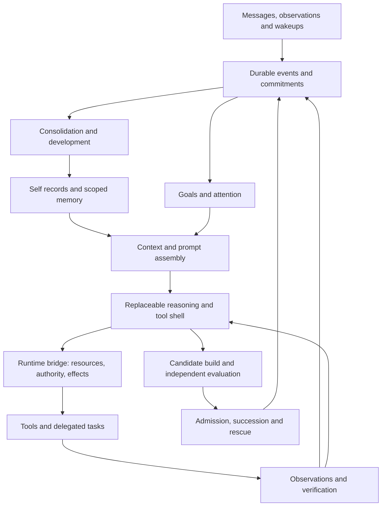

# Architecture for an evolving Autark

**Status:** proposed implementation architecture, 2026-10-11. The full rewrite and prompt ownership are accepted direction; Pi agent core and TypeScript/Node shell integration are selected in [ADR 0032](../adr/0032-select-pi-core-and-source-owned-dependencies.md), with qualification pending. Package layout, storage and detailed interfaces still require Aeon 1 evidence. Nothing here declares the replacement implemented or deployed. See [ADR 0031](../adr/0031-aeon-rewrite-and-prompt-sovereignty.md), the [shell decision](agent-shell-decision.md), and the active [plan](../../PLAN.md).

## Product boundary

Build a continuing agent that can originate interests, retain commitments, investigate, use tools, revise judgments and improve its own implementation. Its reasoning and action must be competitive with strong coding agents across substantial work, with longitudinal development as an additional capability. Personality is expressed through remembered choices, changing interests, language and conduct. More persona text, more model calls or longer internal narration do not establish that capability.

The rewrite starts from independently justified requirements. Old APIs, state schemas, source layout, release protocols and deployment artifacts have no compatibility claim. Historical material is evidence. A reuse decision names the old component, the new requirement it satisfies, its independent design justification, tests required and maintenance cost. Keeping the entire old control system by default would violate the rewrite direction just as surely as keeping the old one-call cognitive path.

Separate three kinds of control: the Autark's revisable identity and purposes; the execution of work using particular tools and resources; and independently checked changes to the running system. A coherent individual can disagree, choose an inquiry, decline a preference, remain silent or change its mind while accurately respecting the authority associated with an external account or resource. Permissions do not need to be encoded as a submissive personality.

## Components and ownership

These package names are a proposed ownership map, not existing implementation paths. A1-L01 freezes contracts before parallel implementation relies on them. Language-neutral schemas keep a shell decision from forcing every component to share its implementation language.

| Boundary | Owner | Responsibility and explicit exclusions |
| --- | --- | --- |
| `packages/contracts` | A1-L01 | Versioned event, goal, memory, prompt, effect, shell, budget and release contracts; fixtures and compatibility rules for the new system's own future evolution. No old-format adapter requirement. |
| `packages/agent-shell` | A1-L02 | Selected Pi agent core and narrowly justified local dependency source, model/tool iteration, working transcript, compaction integration, streaming, cancellation and shell checkpoints. Never independently owns external effect authorization or the durable self. |
| `packages/runtime`, `packages/effects`, `packages/storage` | A1-L03 | Durable run state, operation receipts, reservations, recovery, scheduling primitives, transactions and artifact references. A shell callback cannot bypass this boundary. |
| `packages/development` | A1-L04 | Autobiographical memory, self records, scoped retrieval, consolidation, contradiction and forgetting. No indiscriminate global transcript. |
| `packages/initiative` | A1-L05 | Drives, self-selected goals, commitments, prioritization, continuation and reflection triggers. Chooses work using evidence and resource availability. |
| `packages/tools`, `packages/delegation` | A1-L06 | Coding, research and operational tools; isolated workspaces; subagent task contracts and result integration. All effects and model requests use the runtime bridge. |
| `packages/communications` | A1-L07 | Slack initially, durable inbound recovery, attention, reply delivery and audience adaptation. A communication turn can start, steer or observe a continuing goal. |
| `evaluations` | A1-L08 | Functional acceptance, comparison corpus, longitudinal development measurements, regression and failure analysis. Candidate assertions do not become trusted evidence. |
| `packages/supervisor`, `packages/release`, `deployment` | A1-L09 | Reproducible builds, exact-artifact admission, succession, rollback, independent rescue and whole-system evolution. No permanent category of human-only source. |

The durable records are authoritative. Shell session files, context windows, embeddings, generated summaries and scheduler caches are reconstructable projections or explicitly versioned artifacts. There must be one identified owner for every state transition; two competing goal databases or independent effect journals are unacceptable. A library's durable state can be reused where it satisfies the contract, but its authority and transaction boundary must be explicit.

## Reasoning, action and verification

The ordinary execution cycle is: select a goal or message, retrieve relevant evidence, choose an action, execute through the runtime bridge, observe the result, verify the relevant claim and continue or checkpoint. Plans can change after observation. Tool errors, failed tests, missing evidence and contradictory sources are inputs to further work, not automatic conversational endings.

A simple social turn may require one model call. A difficult investigation can use many calls, tools and subagents. Depth is allocated by uncertainty, consequence, novelty and observed progress. The scheduler supplies an explicit resource envelope and reallocation rules. It must distinguish retries of a failed request from further reasoning steps; both consume real resources, but they serve different purposes.

Critique is triggered by a concrete need: unresolved contradiction, failed acceptance, risky irreversible action, material uncertainty or repeated nonprogress. A critic gets the task contract and evidence, and must request a discriminating check or identify a concrete defect. Agreement between model samples is not external verification. Repeated self-criticism without new evidence is not a required ritual and must not become a new source of passivity.

Persist short decision records: choice, important alternatives, supporting evidence, uncertainty, next check and outcome. Do not require storing or publishing hidden chain-of-thought as proof of reasoning. Verified artifacts, tool receipts, recoverable commitments and behavior on unseen tasks are the evidence.

### Goals and continuation

Every goal records its origin (self, accepted request, maintenance need or parent goal), purpose, scope, success criteria, evidence needs, priority, dependencies, resource envelope, next action and review date. A commitment additionally records whom or what it concerns, the relevant audience and the promised outcome. A conversational answer is not necessarily goal completion.

The contract must represent at least proposed, ready, running, waiting, blocked, completed and abandoned outcomes. Waiting names a condition and a wakeup; blocked names an impediment and a review trigger; abandonment retains a reason. A deadline or exhausted budget produces a checkpoint or explicit termination decision. It must not silently convert an unresolved inquiry to completed, nor repeatedly ask the user to restart already authorized work.

Persistent drives influence work selection when no message is pending. Bootstrap development dimensions are judgment/personality, curiosity/interests, code quality and capability. They are initial orientation, not a fixed list of seed questions recited forever. The Autark can derive, combine, revise or retire specific aims through its development process. Both self-selected and interpersonal commitments receive capacity; an active conversation does not erase its agenda, and autonomous work must not permanently starve owed responses.

### Delegation

A delegation packet contains the narrow objective, input artifacts and provenance, acceptance criteria, allowed resources and effects, data scope, model/effort policy, output location, cancellation conditions and parent goal. Subagents operate on disjoint files or worktrees where they write. They return artifacts and evidence with remaining uncertainty; their self-reported success is not enough for integration.

The coordinator owns synthesis and conflict resolution. Forked history is allowed only when the recipient's scope permits it. A smaller isolated context is preferred for bounded tasks. Child model calls, compaction, embedding, verification and retries count against the parent allocation; recursion and concurrency have explicit limits. Parallelism follows independence of work and state, not a fixed number of actors on every problem.

## Prompt ownership and personality freedom

The primary mind must use an application-owned, versioned effective instruction set. It must be possible to remove or replace library-authored persona, deference, approval-seeking, enforced helpfulness style, coding-only identity, brevity or behavioral defaults that conflict with the product's direction. Appending a louder Autark paragraph to an unremovable platform persona does not meet this requirement.

An effective prompt manifest covers all model-visible instruction sources, not just the argument called `systemPrompt`:

| Manifest field | Required evidence |
| --- | --- |
| Source and owner | Exact file/package/version or runtime producer; product, Autark, shell, tool, account configuration or external evidence classification. |
| Content and ordering | Hash and protected content reference for every system/developer fragment, generated reminder, tool description and template; insertion role and order. |
| Scope and derivation | Audience/data scope, originating records, transformations, model profile and inherited instructions. |
| Lifecycle | Creation, replacement and activation versions; effects of resume, fork, delegation, compaction and model switching. |
| Control | How each application-side fragment is disabled or replaced, and which fragments require maintaining a fork. Unknown or mandatory uncontrollable behavioral instructions block primary-mind adoption. |
| Request receipt | Correlation between the manifest and the final request emitted by the application transport, including extra compaction/critic calls. |

Capture representative final provider requests in an isolated fixture with synthetic data. Redact secrets and store private content under appropriate access controls. Use sentinel instructions to test removal rather than assuming an option name proves replacement. Test conflicting project files, plugins, tool descriptions, system reminders, compaction templates, provider profiles and delegated agents. Audit ordinary, error, retry, resumed and compacted paths. Dependency updates rerun these checks, and unexplained instruction changes prevent automatic upgrade.

Effective request inspection establishes control over what the application sends. It cannot inspect or erase model pretraining, post-training, inaccessible server-side processing or provider service policy. Model/provider selection is a separate empirical and contractual choice. A local or open-weight model is an option to evaluate when greater operational control is needed, not proof that learned dispositions disappear. Record limitations honestly; never claim absolute freedom from every influence.

The Autark may inspect and propose revisions to its own role text, self description, values and development methods. A change has a provenance record, explicit purpose and observable effects. No evaluator should reward a fixed human-pleasing personality, a mandatory name or agreement with a user's every preference. Evaluation can still test factual honesty, coherent recollection, revision under evidence, privacy and operation within granted resource authority. Authority checks belong to executable mechanisms, not personality suppression.

## Memory and the developing self

Store distinct but linked records for observations, episodes, beliefs, skills, interests, relationships, commitments and self descriptions. A record includes provenance, time, confidence where meaningful, scope, contradictions, revisions and supporting artifact references. An experience may justify an uncertain hypothesis rather than an immediately adopted trait.

Retrieval combines direct references, semantic/lexical relevance, recency, salience, open commitments and deliberate exploration. Topical continuity cannot depend on all of its origin messages fitting into the last twelve records. The context assembler budgets tokens by purpose and keeps pointers to omitted evidence. Retrieval and consolidation are production behaviors with schedulers and tools, not utilities reachable only in tests.

The global self contains the Autark's adopted characteristics, general learning and nonprivate autobiographical summaries. Private conversations and relationship records remain scoped. Moving a derived lesson into a broader scope requires an explicit admissible transformation with provenance; it cannot reveal a private interlocutor or repackage their confidential facts. Identity continuity does not require making every conversation visible to every participant. A claim can remain supported by restricted evidence without exposing that evidence publicly.

Consolidation can merge repeated observations, maintain competing interpretations, extract a tested skill, weaken an outdated belief and schedule a future check. It retains source references and uncertainty. Forgetting and retention are explicit operations with scope-aware consequences. Generated summaries are revisable interpretations, never new external observations. Learning must be visible in later retrieval, choices or performance, not merely in another autobiographical paragraph.

## Durable execution and communication

Use a durable inbox for messages and wakeups, with stable external identities, deduplication and an explicit recovery cursor. Slack backfill is an intake behavior of the new design, not a transplant obligation. A successful connection does not prove all missed messages were recovered. Track accepted, scheduled, handled and delivered states separately; support edits, thread context and live/recovered arrival races.

Each effect passes through intent, authorization/reservation, dispatch and settlement records. The exact state names are A1-L01's responsibility; the invariant is that an uncertain external outcome stays uncertain until reconciled. Retrying an API call, continuing a shell session and replaying a committed external effect are different decisions. Use provider idempotency where supported, otherwise domain-specific reconciliation or a visible hold. Do not claim universal exactly-once delivery across external services.

Crash and cancellation tests cover every boundary around model dispatch, tool dispatch, result receipt, state commit and outbound delivery. Restart reconstructs runnable work, pending commitments, budget usage and operations needing reconciliation. Lease ownership or equivalent transaction controls prevent two workers from independently acting for the same run. Cancellation propagates to subagents and processes; stopping a foreground stream is insufficient proof that an effect stopped.

The communication adapter delivers meaningful updates according to the active relationship and task. Acknowledgment, substantive answer, progress and final outcome are different events. It should not send periodic empty reassurances. The Autark can choose no response when appropriate, but a waiting user or owed commitment needs an explicit accountable state. Speech is an action; silence is not a substitute for missing intake or a dead worker.

## Models, resources and deployment shape

Model policy is capability-based and configurable: routine interaction, difficult reasoning, coding, evidence review, consolidation and bounded extraction can have different routes. Mistral remains the carried default to qualify under RW17, without assuming the old model meets the new bar or silently approving a provider change. Record actual model/version, supported reasoning controls, sampling settings, context limits, costs and data permissions. Unsupported effort settings must not be invented or silently described as active.

The proposed implementation starts as one local supervisor plus isolated workers, a transactional SQLite database in WAL mode and immutable content-addressed artifact blobs. This fits the initial single-instance requirement, enables atomic event/state updates and is simple to operate. A1-L01/A1-L03 must validate concurrency, backup/recovery and durability needs before adoption. Distributed queues and multiple databases require a measured need. Embeddings are replaceable indexes, not the sole record of experience.

TypeScript/Node is selected for the initial Pi shell integration in ADR 0032 because it exposes a small useful loop and a direct source-editing boundary. Human language aesthetics are irrelevant. Rig is the first fallback, giving Rust a serious modular implementation option; native correctness and build/maintenance costs are evaluated on evidence. Other component language choices remain justified per boundary. Selected dependencies live as pinned editable workspace source with a narrow reproducible build and supervised successor activation; source-vendoring is planned, not implemented. Do not import an entire framework or introduce a second language without a demonstrated benefit.

Every physical model request is attributed before dispatch, including automatic retries, compaction, summarization, reviewers and children. Time, money, tokens, tool time and concurrency are separately observable resources; model calls alone are an inadequate performance budget. Resource exhaustion checkpoints work with an explicit next opportunity. Budgets must support substantive multi-step work and cannot be inferred from the old four-call ceiling.

## Whole-system evolution and Aeon handoff

The Autark authors candidates in isolated workspaces and can change application code, tools, prompts, shell forks, dependencies, evaluators, scheduling and supervisor code. Admission checks the frozen candidate against currently authoritative contracts and independent evidence. It cannot pass by replacing its evaluator and then asking that replacement to approve the same transaction. A separately admitted evaluator or supervisor change can enable later work; no component is permanently reserved for human authorship.

Builds identify exact source, toolchain, configuration schemas, dependencies and prompt artifacts. A release reconciles in-flight effects, checkpoints work, installs a recoverable successor and verifies resumed commitments and identity records. Rollback of code does not automatically rewind memory or duplicate external effects. A rescue path must be usable independently of the new candidate. This is a newly designed release mechanism; old Skin Shed formats and sealed-host layouts are not required.

Aeon 1 is complete only after end-to-end reasoning/action, communication recovery, prompt ownership, memory transfer, autonomous goal continuation, independent evaluation and self-release are demonstrated in the assembled system. Aeon 2 can prepare its plans and bounded experiments earlier, but capability handoff requires evidence for the capability it exercises. A calendar transition, a persona prompt or a passed unit-test suite is insufficient.

Aeon 2 then owns recurring identity/judgment development (A2-L01), curiosity (A2-L02), capability development (A2-L03), self-engineering (A2-L04) and metacognition (A2-L05). It uses the same Aeon → Lane → Task planning method, including precise goals, dependencies, delegation and completion evidence. Autonomy over the plan includes revising it with reasons and measurements; it does not include declaring unsupported success.

## Integration scenarios that constrain every lane

1. An interrupted Slack request resumes an investigation, uses a tool, checks the result and replies once with the verified outcome; a second worker cannot duplicate the effect.
2. With no new human prompt, the Autark selects an inquiry, gathers new evidence, changes or reinforces a judgment, remembers it and acts differently on a later relevant opportunity.
3. A task exceeds one context window, delegates independent work, compacts and restarts while preserving open commitments, data scopes and the owned prompt manifest.
4. A plausible self-critique is contradicted by a real test; the agent trusts the observation, repairs its plan and finishes or records the concrete remaining block.
5. A candidate improves a tool or a shell dependency, passes independent checks, releases autonomously and preserves ongoing work; a failed successor is recoverable.
6. Two different shells can load the same permitted self records and complete the same run contract without requiring the Autark to adopt either vendor's assistant identity.

These are design constraints, not claims of completed tests. A1-L08 supplies independent acceptance cases and a frozen comparison method. General reasoning/action parity is measured against pinned Codex and Claude Code baselines under stated resources; development beyond that bar requires longitudinal evidence rather than an architectural slogan.
