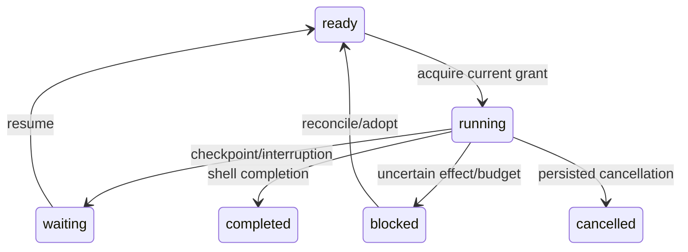

# Durable storage, runtime and effect implementation

A1-L03-T01–T05 owner `/root/a1_runtime`, base `3398077`, contract `aeon1.c1.v1`. This is implemented and fixture-verified, with the selected Pi shell joined against deterministic transport responses. It is not live Mistral qualification, deployment or final independent lane acceptance.

## Behavioral specification and mechanism

A committed authenticated input, run creation and shared resource allocation are one synchronous SQLite transaction. Duplicate deliveries return the original run; conflicting reuse of input identity fails. Document updates compare revisions inside `BEGIN IMMEDIATE`; nested operations use savepoints. Events are immutable, globally sequenced, deduplicated by exact identity and committed alongside projections. Artifacts bind exact bytes with SHA256 and are verified on read. `putJsonArtifact` explicitly encodes JSON strings; `putArtifact` strings preserve raw request bytes. New state is external to the checkout, including resolved symlink aliases. SQLite WAL/FULL durability, serialized schema initialization, integrity checks and column diagnostics fail visibly on incompatible storage.



Effects persist `pending → authorized → dispatched` before crossing the receiver. Both the host journal and receiver assert exact epoch/generation/control authority before dispatch. Any thrown dispatch or startup discovery of a dispatched effect preserves an uncertain outcome; no automatic replay follows. Reconciliation can observe an older generation, without granting dispatch authority. Late receipts remain evidence after withdrawal/recovery. Effect IDs bind original payload, scope, run, step, authority and idempotency key. No exactly-once network claim is made.

The selected shell owns the cognition loop. The runtime provides durable observations, prompt byte capture, physical reserve/dispatch/settle, shell checkpoints, cancellation, steering, atomic admission, explicit generation adoption and startup recovery. On resume a checkpoint reference is rebound to the current run revision while its digest and content stay unchanged. A durable message cursor prevents already-consumed inbound messages being replayed. Input values become user messages; they cannot spoof assistant/tool roles. Shell-supplied observation order is preserved and checked against durable receipts.

All model requests, compaction, review, retry, child allocations and tool effects share the root envelope; each child and its descendants also enforce that child’s narrower envelope. Unknown usage retains configured conservative token/cost/time ceilings through restart. Recorded actual over-ceiling usage freezes further work while preserving the true observed usage. Child cancellation leaves sibling/parent allocations available; parent cancellation bars descendants. Budgets enforce reservations, elapsed deadlines and concurrency before dispatch. Physical records cannot change provider/model/digest/parent/allocation identity during dispatch or settlement.

## Observed checks

Node `24.13.0`, TypeScript `7.0.2`, root-selected Pi shell `89e5c2c/aeon-bridge-v1`, local `typebox` dependency. Commands run with the pinned Node binary:

```text
node node_modules/typescript/bin/tsc --noEmit
node --test packages/storage/test/storage.test.ts packages/effects/test/effects.test.ts packages/runtime/test/runtime.test.ts packages/runtime/test/resources.test.ts packages/runtime/test/shell-joined.test.ts
```

Strict typecheck passed. The combined suite passed 18 cases, zero failures/skips. Evidence includes real child-process `SIGKILL`, SQLite reopen and continuation, rather than memory-only reducers:

| Boundary | Observed retained state / behavior |
|---|---|
| Transaction throws after input projection + event append | Both roll back; no acknowledged half-write |
| SIGKILL after fake-shell inspection/checkpoint | Reopen retains actual inspection value; continuation dispatches test only |
| SIGKILL during receiver dispatch | Ledger reopens uncertain; resume invokes no shell and dispatches nothing until explicit reconciliation |
| Older effect / newer authority | Reconciliation records success; explicit adoption permits continuation; the prior grant never re-dispatches |
| Withdrawal while old receipt is arriving | Receipt settles the existing effect without a second dispatch |
| Cancel running shell | Signal drains shell; later bridge effect is refused; cancelled state survives reopen |
| Unknown model usage / child compaction | Conservative shared ceilings persist; review/retry beyond total envelope is refused |
| Selected Pi failure → repair → verification | Four observed tool actions and five captured physical model requests, nine total; five unknown costs retain five fixture ceilings |
| Selected Pi pending tool after uncertain outcome | Reconciled receipt reconstructs result, second shell invocation makes no duplicate effect |
| SIGKILL selected Pi during following model request | Retains inspection/tool-result checkpoint; fresh process continues using inspection; zero tool replay; interrupted model usage remains uncertain |

The initial joined checks exposed string artifact encoding and receipt source/index mismatches; these were corrected and the final suite rerun. No passing claim relies on those failed initial attempts.

## Integration API and remaining gates

`OperationalStore` is the single storage engine for runtime/development/initiative namespaces. L04/L05 own their meanings; root owns overall configuration and startup. `EffectJournal(store, authorityStore, receiver)` accepts the root `AuthorityStore.assert` API. The receiver must assert at its physical boundary too. `ResourceLedger(store, perRequestCeiling)` requires explicit conservative host ceilings. `DurableRuntime({store,shell,effects,resources})` offers `admit`, `steer`, `resume`, `cancel`, `recover`, `adopt`, `getRun`, `observations` and a C1 `bridge`.

Call `recover()` only after the supervisor obtains exclusive serving authority. Explicitly adopt resumable old-generation runs. Reconcile effects before resumption; settle physical usage receipts independently when available. Unknown usage is never silently zeroed. State directories remain outside source checkouts and are not copied when selecting another executable generation.

Bridge settlement/dispatch rejects foreign run receipts. Checkpoint reads require the assigned artifact/shell/observation index; checkpoint writes require currently running authority, including after cancellation. Late usage settlement for the bridge’s own run remains permitted. A cancelled shell cannot persist a final drained transcript after cancellation, but previously committed checkpoints and all effect/request records survive. Host broker isolation (no candidate keys or storage handles) is root-owned and pending; current fixtures call trusted in-process bridges.

Pending: independent consequential review; production L06 receiver and L07 inbox/obligation integration; authentic provider/tool transport receipts and real interruption/recovery matrix; explicit live model spend/qualification; held-out evaluation and H1. Fixture tools simulate inspect/edit/test outcomes, so they prove bridge/recovery mechanics rather than real coding competence. This is an early implementation handoff, not final A1-L03 acceptance.
